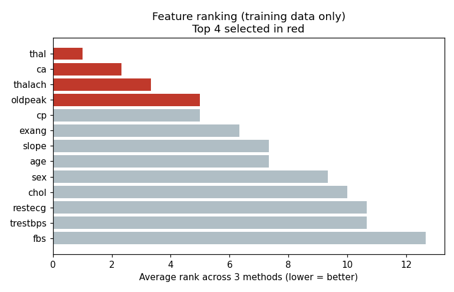
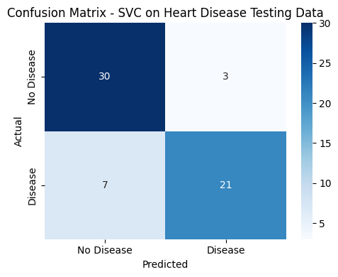
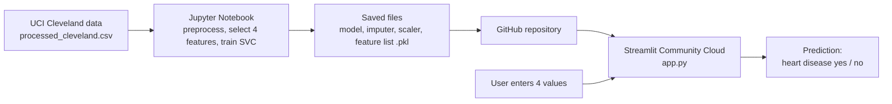

# Heart Disease Prediction System

An end-to-end machine learning system that predicts whether a patient has heart disease from four medical measurements. It covers the full cycle taught in the course: data collection, data understanding, preprocessing, feature selection, training, testing, application, feedback and cloud deployment as a public web app.

A user opens the live web page, enters four values, and the trained model returns its prediction of heart disease.

**Python • pandas • scikit-learn • Support Vector Classifier • Jupyter Notebook • Streamlit • GitHub**

> 🔗 **Live demo:** `PASTE-YOUR-STREAMLIT-LINK-HERE`
> *(Replace this with your `https://….streamlit.app` link after deploying.)*

## Overview

| | |
|---|---|
| **What it is** | A binary classification system (heart disease: yes / no) built from the UCI Heart Disease dataset, with a deployed web interface. |
| **Who it is for** | Machine learning students who want a complete, beginner-friendly example from raw data to a live app, and instructors reviewing the full workflow. |
| **Problem it solves** | Shows how a trained model becomes a usable product: the same preprocessing used in training is applied to every new patient entered in the app. |
| **What makes it useful** | Only four inputs are needed, the feature choice is data-driven and reproducible, there is no data leakage, and the notebook is written step by step so it can be explained in a viva. |

> ⚠️ **Educational project only.** This is a learning exercise built on a small public dataset. It is **not** a medical device and must not be used to diagnose or treat anyone.

## 📸 Screenshots and Results

Screenshots of the results below come from the notebook run on the Cleveland data.

### Feature selection
Every attribute was ranked on the **training data only**. The four best (red) were selected.



### Model evaluation
Confusion matrix on the 61 held-out test patients.



### Web app
*Add a screenshot of your deployed app here after deployment, for example `screenshots/app.png`, then uncomment the line below.*

<!--  -->

## 🏗️ System Architecture



The notebook and the web app share the same saved files. The app loads the exact model, imputer, scaler and feature order created during training, so training and deployment can never drift apart.

## ✨ Features

### Machine Learning Pipeline
- Loads the official UCI **Cleveland** database and assigns the UCI column names (the file has no header). `?` values are read as missing.
- Converts the original diagnosis `num` (0 to 4) into a **binary target**: 0 = no disease, 1 to 4 = disease.
- Fills the 6 missing values with training-set medians instead of deleting patients.
- Splits the data 80% training / 20% testing, stratified so both parts keep the same disease ratio.
- Selects **exactly four** input attributes using three ranking methods, on training data only (details below).
- Scales the inputs with `StandardScaler` fitted on training data only.
- Trains a **Support Vector Classifier**, the same model as the instructor's Titanic notebook.
- Saves the model, imputer, scaler and the ordered feature list to disk, then reloads them for testing and for the app.

### Evaluation
- Accuracy (testing and training), precision, recall, F1-score and a confusion matrix with a heatmap.
- A plain-language explanation of the results, generated from the actual numbers.
- Honest limitations are listed in the notebook (small dataset, small test set, four-attribute restriction).

### Web App
- Four clearly labelled inputs with limits: a dropdown for `thal`, a dropdown for `ca`, and bounded numeric fields for `thalach` and `oldpeak`.
- Applies the same imputer and scaler as training, in the same feature order.
- Shows the result clearly labelled as the **model's prediction of heart disease**.
- Handles missing files, invalid or missing values with clear error messages.

### Notebook Workflow (Steps 1 to 10)
Follows the instructor's Titanic notebook: Import Libraries → Load Data → Understand and Pre-process → Feature Selection → Numeric Representation → Training Phase → Testing Phase → Application Phase → Feedback Phase → Deployment.

## 🧬 Dataset

| | |
|---|---|
| **Source** | [UCI Heart Disease dataset](https://archive.ics.uci.edu/dataset/45/heart+disease) |
| **Database used** | Cleveland (`processed_cleveland.csv`), 303 patients, 14 columns |
| **Target** | `num`, converted to binary `target` (164 no disease, 139 disease) |
| **Missing values** | 6 in total (`ca`: 4, `thal`: 2) |

The UCI collection has four databases (Cleveland, Hungarian, Switzerland, VA Long Beach). They were **not combined**. Cleveland is the only one that is almost complete; in the others, `ca` and `thal` are mostly missing (for example 291 of 294 `ca` values in Hungarian).

### Input attributes used by the model

| Attribute | Meaning | Values |
|---|---|---|
| `thal` | Thallium stress-test result | 3 = normal, 6 = fixed defect, 7 = reversible defect |
| `ca` | Major vessels coloured by fluoroscopy | 0, 1, 2, 3 |
| `thalach` | Maximum heart rate achieved (bpm) | Number, about 70 to 200 |
| `oldpeak` | ST depression induced by exercise | Number, 0.0 to 6.2 |

## 🎯 Feature Selection

The assignment allows only four inputs, so they were chosen by evidence, not guesswork. Each of the 13 candidate attributes was ranked on the **training data only** by three methods:

1. **ANOVA F-score**: how different the attribute is between the two classes.
2. **Mutual information**: how much the attribute tells us about the target.
3. **Random Forest importance**: how much a Random Forest relies on the attribute.

The **average rank** decides the winners; ties are broken by the higher F-score.

| Attribute | Rank (F) | Rank (MI) | Rank (RF) | Average rank |
|---|---|---|---|---|
| **thal** | 1 | 1 | 1 | **1.00** ✅ |
| **ca** | 2 | 2 | 3 | **2.33** ✅ |
| **thalach** | 3 | 5 | 2 | **3.33** ✅ |
| **oldpeak** | 4 | 7 | 4 | **5.00** ✅ |
| cp | 6 | 3 | 6 | 5.00 |
| exang | 5 | 4 | 10 | 6.33 |

`oldpeak` and `cp` tied for fourth place; `oldpeak` won on the F-score tie-break. These are results on this dataset's training data, not a claim that these are the objectively best four attributes in general.

## 🚫 No Label Encoding

As instructed, label encoding is **not** used. The Titanic data contained words (`Male`, `First`), but the heart disease data is already numeric: categorical attributes such as `thal` are stored as official UCI numeric codes, and those codes are used as they are.

## 📊 Results

Evaluated on **61 test patients** the model had never seen (random split, `random_state=0`).

| Metric | Value |
|---|---|
| Testing accuracy | **0.84** |
| Training accuracy | 0.82 |

| Class | Precision | Recall | F1-score | Patients |
|---|---|---|---|---|
| No heart disease (0) | 0.81 | 0.91 | 0.86 | 33 |
| Heart disease (1) | 0.88 | 0.75 | 0.81 | 28 |

- 51 of 61 predictions were correct (21 disease cases and 30 healthy cases).
- 7 patients **with** heart disease were missed, and 3 healthy patients were wrongly flagged. In a medical setting, missed cases are the costly mistake, so improving recall would be the first goal.
- With only 61 test patients, the scores can change noticeably with a different split.

## 🛠️ Tech Stack

| Technology | Purpose |
|---|---|
| Python 3 | Programming language |
| pandas, NumPy | Data loading and handling |
| scikit-learn | Imputation, scaling, feature ranking, SVC model, metrics |
| Matplotlib, Seaborn | Confusion matrix and charts |
| PrettyTable | Clean prediction table in the notebook |
| Pickle | Saving and loading the model and preprocessing objects |
| Jupyter Notebook | Development and documentation of the workflow |
| Streamlit | Web interface |
| GitHub + Streamlit Community Cloud | Public cloud deployment |

## 📁 Project Structure

```
heart-disease-prediction/
├── Heart_Disease_Prediction.ipynb   # Main assignment notebook (already run)
├── app.py                           # Streamlit web app
├── requirements.txt                 # Packages for the deployed app
├── heart_disease_model.pkl          # Trained SVC model
├── imputer.pkl                      # Fitted missing-value filler
├── scaler.pkl                       # Fitted StandardScaler
├── selected_features.pkl            # The 4 feature names, in order
├── processed_cleveland.csv          # Original UCI Cleveland data
├── heart-disease-prepared.csv       # Same data with column names and binary target
├── training-data.csv                # 80% split
├── testing-data.csv                 # 20% split
├── training-data-prepared.csv       # Training data after filling and scaling
├── model-predictions.csv            # Actual vs predicted on the test set
├── screenshots/                     # Images used in this README
└── README.md
```

## ⚙️ Getting Started (run the notebook locally)

Requires Python 3.11 or newer (needed by scikit-learn 1.8.0).

```bash
git clone <repository-url>
cd heart-disease-prediction
python -m venv venv
# Windows:  venv\Scripts\activate      macOS/Linux:  source venv/bin/activate
pip install numpy pandas scikit-learn==1.8.0 matplotlib seaborn prettytable jupyter
jupyter notebook
```

Open `Heart_Disease_Prediction.ipynb` and choose **Kernel → Restart & Run All**. This recreates every CSV and `.pkl` file.

If you use a different scikit-learn version, re-run the notebook so the `.pkl` files are rebuilt with your version, and change the version in `requirements.txt` to match.

### Run the web app locally (optional)

```bash
pip install streamlit
streamlit run app.py
```

Then open http://localhost:8501. The cloud deployment below does not need this.

## ☁️ Deployment (Streamlit Community Cloud)

1. Upload the project files to a **public** GitHub repository, with `app.py` and the `.pkl` files at the top level (not in a subfolder).
2. Go to [share.streamlit.io](https://share.streamlit.io) and sign in with GitHub.
3. Click **Create app → Deploy a public app from GitHub**.
4. Select your repository, branch `main`, and main file `app.py`.
5. Under **Advanced settings**, set the Python version to **3.12** (or 3.11), then click **Deploy**.
6. Copy the final `https://….streamlit.app` link into this README and the top of the notebook.

Files the app needs: `app.py`, `requirements.txt`, `heart_disease_model.pkl`, `imputer.pkl`, `scaler.pkl`, `selected_features.pkl`.

**Troubleshooting**
- *`ModuleNotFoundError` or version error:* set Python to 3.11 or 3.12 in app settings and reboot.
- *"A required file is missing":* a `.pkl` file is not in the repository root.
- *App is asleep:* free apps sleep when unused; click **Wake up** and wait about 30 seconds.

## 🧪 Testing and Validation

There is no automated test suite. The checks performed on this project were:

- The notebook was executed from a clean folder, top to bottom, with all outputs saved in it.
- Exactly four features are enforced in the notebook (`assert len(selected_features) == 4`) and in the app.
- The saved model, imputer, scaler and feature list are reloaded and used for a prediction (Step 10 cell), which is the same logic as `app.py`.
- The notebook and app were searched to confirm that no label encoding code exists.
- Scaler and imputer are fitted on training data only; the test data uses `transform` only.

## 🔐 Data Handling Notes

- No patient data is stored by the app: inputs are used for one prediction and are not saved.
- Test data is never used to choose features, fill missing values, fit the scaler or train the model.
- The original dataset file is never modified; prepared data is written to separate files.

## 🚀 Future Improvements

These are ideas, not current features.

- Use cross-validation for a more stable accuracy estimate.
- Compare other models (Logistic Regression, Decision Tree, Random Forest), tuning only on training data.
- Add more input attributes (such as chest pain type and age) if the four-attribute limit is lifted.
- Aim for higher recall so fewer disease cases are missed.
- Show prediction confidence in the app.
- Have clinicians review the predictions before any real-world use.

## 👨‍💻 Project Purpose

This project was built for **AIC354 Machine Learning Fundamentals, Assignment 2: Developing an End-to-End Machine Learning System** at COMSATS University Islamabad, Lahore Campus. It adapts the instructor's Titanic Passenger Survival notebook into a Heart Disease Prediction System, following the same steps and deploying the trained model to the cloud.

| | |
|---|---|
| **Student** | M.Ahmed Waqar |
| **Roll number** | FA24-BSE-070 |
| **Course** | AIC354 Machine Learning Fundamentals |
| **Instructor** | Dr. Rao Muhammad Adeel Nawab |
| **University** | COMSATS University Islamabad, Lahore Campus |

## 📚 Acknowledgements

- Dataset: [UCI Machine Learning Repository, Heart Disease](https://archive.ics.uci.edu/dataset/45/heart+disease) (Cleveland database).
- Notebook structure and workflow: the instructor's Titanic Passenger Survival Prediction notebook.

## 📄 License

License information will be added when the project is formally licensed. The dataset remains subject to the terms of the UCI Machine Learning Repository.
